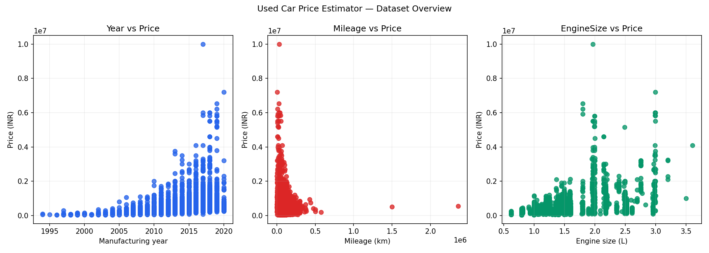
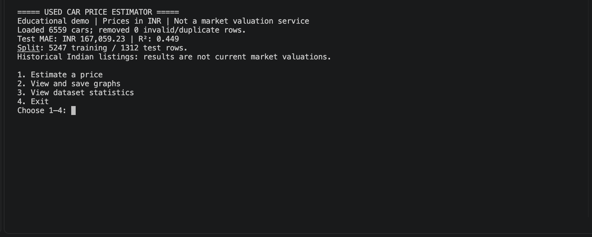
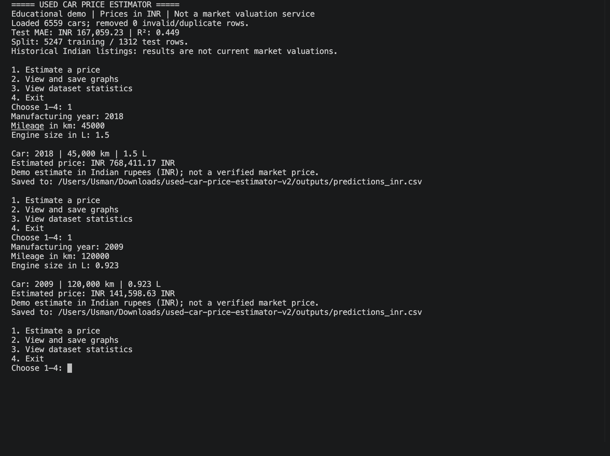
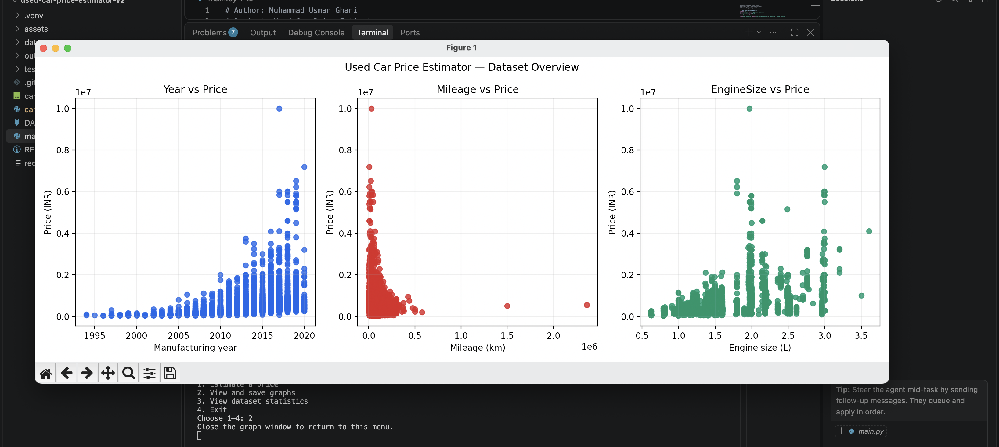

# Author: Muhammad Usman Ghani
# Project: Used Car Price Estimator
# Course: Programming for AI


Python course project by Muhammad Usman Ghani, updated with a larger historical dataset and non-blocking extrapolation warnings.

## Run on Mac

Open this extracted folder in VS Code and open a new terminal:

```bash
python3 -m venv .venv
source .venv/bin/activate
python -m pip install -r requirements.txt
python main.py
```

For subsequent sessions, run just the activation and `python main.py` commands.

On Windows PowerShell, replace the first two commands with `py -m venv .venv` and `.venv\Scripts\Activate.ps1`.

## What changed

- Removed hard training-range limits on manufacturing year, mileage and engine size. Out-of-range inputs produce a warning and an estimate, not a range rejection.
- Basic validity checks remain: finite numbers, whole manufacturing year from 1886 through the current year, mileage at least zero, and engine size greater than zero. No dataset-based upper mileage or engine limit is imposed.
- Replaced the 30-row active CSV with **6,559 cleaned unique four-column records** from the public CarDekho v3 dataset. No synthetic observations were generated.
- Preserved the original 30 rows separately in `data/original_course_data_usd.csv`. They are not mixed into training because the original report labels their prices in USD.
- Prices are now **Indian rupees (INR), not USD or Pakistani rupees (PKR)**. No currency conversion was applied.
- Uses Linear Regression on log(price), transformed back with exp, to avoid negative predictions without clipping them to an invented minimum. This changes the original model and its outputs.
- Keeps the four classes, repeated-prediction menu, optional charts, CSV history and file-error handling.

## Menu and examples

Choose `1` to estimate, `2` for charts, `3` for statistics, or `4` to exit.

| Year | Mileage (km) | Engine (L) | Estimated INR |
| --- | ---: | ---: | ---: |
| 2025 | 1200 | 1.1 | 1,496,805.30 |
| 2023 | 1200 | 1.2 | 1,229,691.29 |
| 2001 | 10000 | 1.4 | 71,300.31 |

These are example model outputs, not verified valuations. The 2025 and 2023 examples trigger a warning because the dataset ends in 2020, but they are accepted. Extreme numeric inputs can still cause an unusable model result, which is reported rather than saved as a price.

Predictions save to `outputs/predictions_inr.csv` with UTC timestamps. Charts save to `outputs/car_graphs.png`; close the chart window to return to the menu. Generated outputs are excluded from Git.

## Data and evaluation

See [DATA_SOURCE.md](DATA_SOURCE.md) for attribution, transformation, units and dataset licensing.

The cleaned dataset covers 1994–2020, 1–2,360,457 km, and 0.624–3.604 L. Large mileage outliers remain in the source; missing values, invalid values and identical four-column rows were removed. This is basic cleaning, not a full audit of listing accuracy.

The fixed 80/20 split (`random_state=42`) contains **5,247 training and 1,312 test rows**. In local validation:

- MAE: approximately **INR 167,059.23**
- R²: approximately **0.449** (not percentage accuracy)

The model remains fitted on the training partition. Historical listing prices are not confirmed sale prices or current market prices. Brand, model, condition, fuel, transmission and location are omitted. Extrapolation may be substantially wrong; positive output does not imply a reliable estimate. Log-price inversion does not include a mean-price bias correction.

The previous USD dataset's R² of 0.95 is not comparable to this different dataset and target treatment. Do not claim improved real-world accuracy just because the row count increased. The new dataset and model remain educational.



## Files

- `main.py`: menu, inputs and prediction logging.
- `car_predictor.py`: car validation, data preparation, model and charts.
- `car_data.csv`: active cleaned INR dataset.
- `data/original_course_data_usd.csv`: original dataset backup, not active.
- `DATA_SOURCE.md`: attribution and data preparation details.
- `requirements.txt`: direct dependency versions matching the previous Mac setup.
- `tests/test_project.py`: automated checks.

Run tests with `python -m unittest discover -s tests -v`.

If submitting the old report or updating your resume, revise its dataset size, currency, model description and evaluation values to match this version. The original report is not included because it describes the earlier project.
## Application Screenshots

### Startup and Menu


### Price Prediction


### Graphs
